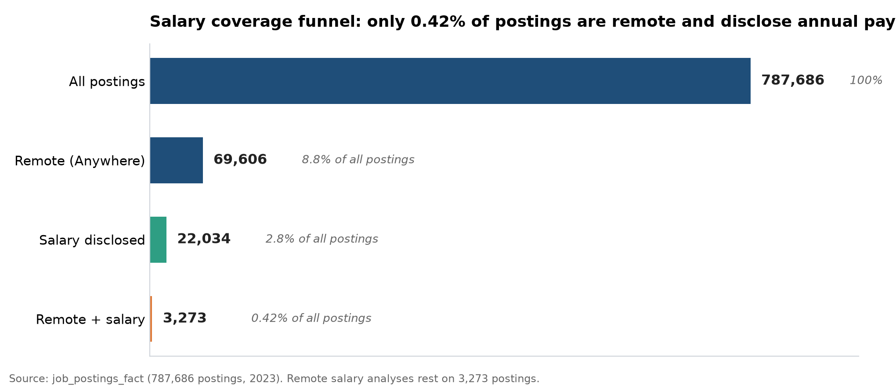
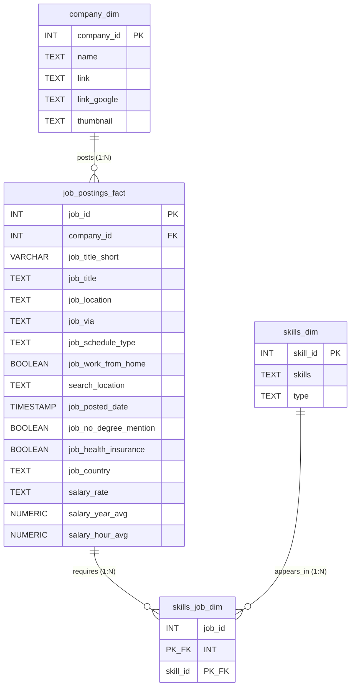
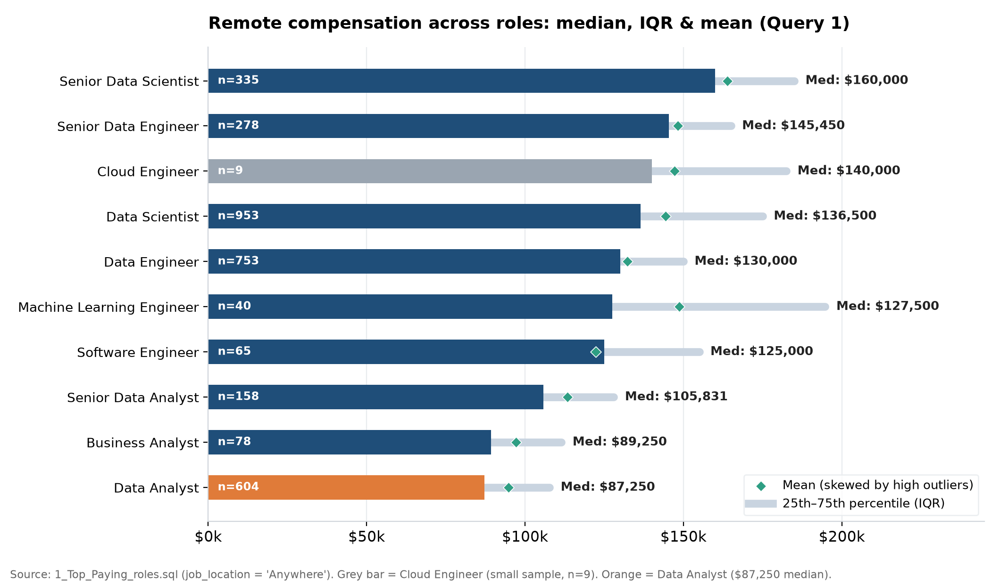
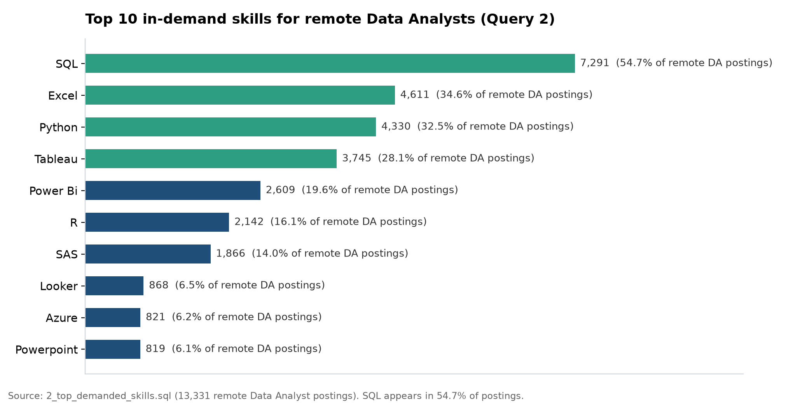
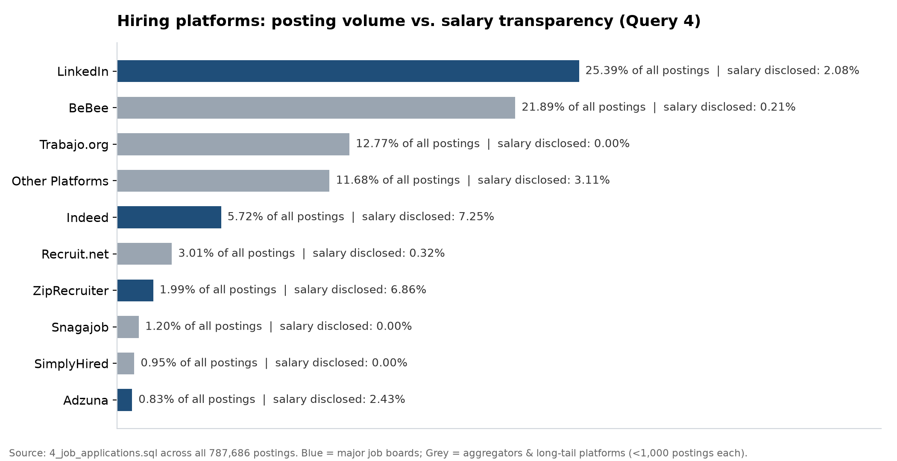
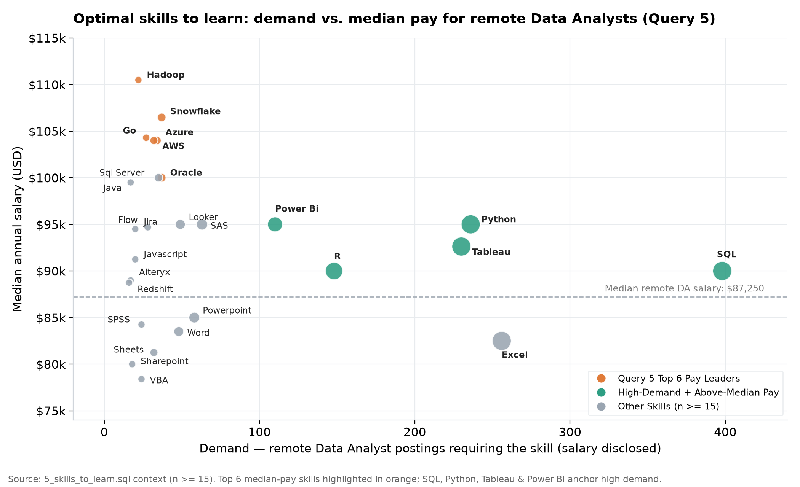

# Introduction

📊 Dive into the 2023 data job market! Building on the dataset and star schema from Luke Barousse's SQL course, this project expands beyond a single role to explore **remote compensation across data roles**, 🔥 **in-demand Data Analyst skills**, 💰 **high-paying technical skills**, 🌐 **where roles are posted across hiring platforms**, and 🎯 **the optimal skills to learn**.

🔍 SQL queries? Check out all 5 scripts directly in this repository:
1. [1_Top_Paying_roles.sql](1_Top_Paying_roles.sql)
2. [2_top_demanded_skills.sql](2_top_demanded_skills.sql)
3. [3_Top_paying_off_skills_for_each_role.sql](3_Top_paying_off_skills_for_each_role.sql)
4. [4_job_applications.sql](4_job_applications.sql)
5. [5_skills_to_learn.sql](5_skills_to_learn.sql)

---

# Background

Navigating the data job market requires answering two questions at once: *which career paths and skills command the highest pay*, and *which platforms actually list quality, salary-transparent roles?*

While Luke Barousse's capstone focuses exclusively on **Data Analyst** positions, I structured my SQL project to examine **multiple data roles** and **hiring channels** across **787,686 job postings** (Dec 31, 2022 – Dec 31, 2023) stored in `csv_files/`.

### The questions I wanted to answer through my SQL queries were:

1. **What are the top-paying remote data roles** using median and quartile pay to control for salary outliers?
2. **What skills are most in demand** (by posting count and market share %) for remote Data Analysts?
3. **Which skills pay the most** across salary-disclosed data postings?
4. **Which hiring platforms (`job_via`) post the most jobs**, and how transparent are they about salary?
5. **What are the optimal skills to learn** for remote Data Analysts (balancing demand with high median pay)?

### Data Coverage & Scope

Before interpreting any salary metric, it is critical to see how much of the 787,686-posting dataset actually discloses annual compensation (`salary_year_avg`):


*Coverage funnel across `job_postings_fact`: only 2.8% of all postings (22,034) disclose an annual salary, and 0.42% (3,273) are both remote (`Anywhere`) and disclose annual pay.*

---

# Data Model

The database follows a 4-table **star schema** linking `job_postings_fact` (`787,686` rows) to `company_dim` (`140,033` rows) and `skills_dim` (`259` rows) via the many-to-many bridge table `skills_job_dim` (`3,669,604` rows).


---

# Tools I Used

- **SQL (PostgreSQL):** Multi-table joins, percentile aggregations (`PERCENTILE_CONT`), CTEs, regex string normalization, and window functions (`OVER (PARTITION BY ...)`).
- **Visual Studio Code & PostgreSQL / DuckDB:** Query authoring, schema inspection, and verification against `csv_files/`
- **Git & GitHub:** Version control and portfolio presentation.

---

# The Analysis

### 1. Top-Paying Remote Data Roles
📁 File: [1_Top_Paying_roles.sql](1_Top_Paying_roles.sql)

Because salary distributions are heavily right-skewed (for example, a single \$650,000 Data Analyst posting pulls the average well above typical pay), I used `PERCENTILE_CONT` to report the **median**, **25th percentile (`p25`)**, and **75th percentile (`p75`)** alongside the mean across remote roles (`job_location = 'Anywhere'`).

```sql
SELECT
    job_title_short,
    COUNT(*) AS total_postings,
    ROUND(PERCENTILE_CONT(0.50) WITHIN GROUP (ORDER BY salary_year_avg)) AS median_salary,
    ROUND(AVG(salary_year_avg), 0) AS mean_salary,
    ROUND(PERCENTILE_CONT(0.25) WITHIN GROUP (ORDER BY salary_year_avg)) AS p25_salary,
    ROUND(PERCENTILE_CONT(0.75) WITHIN GROUP (ORDER BY salary_year_avg)) AS p75_salary
FROM job_postings_fact
WHERE
    job_location = 'Anywhere'
    AND salary_year_avg IS NOT NULL
GROUP BY job_title_short
ORDER BY median_salary DESC;
```

**Results (All 10 Remote Roles Ranked by Median Salary):**

|job_title_short          |total_postings|count_companies|median_salary|mean_salary|p25_salary|p75_salary|
|-------------------------|--------------|---------------|-------------|-----------|----------|----------|
|Senior Data Scientist    |335           |335            |160000       |163798     |140000    |185000    |
|Senior Data Engineer     |278           |278            |145450       |148245     |132500    |165000    |
|Cloud Engineer           |9             |9              |140000       |147111     |110000    |182500    |
|Data Scientist           |953           |953            |136500       |144398     |111500    |175000    |
|Data Engineer            |753           |753            |130000       |132364     |110000    |150000    |
|Machine Learning Engineer|40            |40             |127500       |148670     |92500     |194750    |
|Software Engineer        |65            |65             |125000       |122367     |85000     |155000    |
|Senior Data Analyst      |158           |158            |105831       |113335     |96250     |128031    |
|Business Analyst         |78            |78             |89250        |97114      |72500     |111500    |
|Data Analyst             |604           |604            |87250        |94770      |75000     |107750    |



- **Analysts Trail Engineering & Science:** Even Senior Data Analysts (\$105,831 median) sit below mid-level Data Engineers (\$130,000) and Data Scientists (\$136,500), while entry/mid-level Data Analysts have the lowest median (\$87,250).
- **Why Medians Matter:** On Data Analyst postings, the mean (\$94,770) is \$7,520 higher than the median (\$87,250) due to high-end outliers.

---

### 2. Most In-Demand Skills for Remote Data Analysts
📁 File: [2_top_demanded_skills.sql](2_top_demanded_skills.sql)

To measure both raw demand and **share of remote Data Analyst postings** (out of `13,331` remote Data Analyst jobs), I joined `job_postings_fact` through `skills_job_dim` to `skills_dim` and computed `pct_of_postings`.

```sql
SELECT 
    skills,
    COUNT(skills_job_dim.job_id) AS demand_count,
    ROUND(100 * COUNT(skills_job_dim.job_id) / (
            SELECT COUNT(*) 
            FROM job_postings_fact 
            WHERE job_title_short = 'Data Analyst' 
              AND job_work_from_home = true),1) AS pct_of_postings
FROM job_postings_fact
INNER JOIN skills_job_dim ON job_postings_fact.job_id = skills_job_dim.job_id
INNER JOIN skills_dim ON skills_job_dim.skill_id = skills_dim.skill_id
WHERE 
    job_title_short = 'Data Analyst' 
    AND job_work_from_home = true 
GROUP BY
    skills
ORDER BY
    pct_of_postings DESC,
    demand_count DESC;
```

**Top 10 Most In-Demand Skills (from 201 returned skills):**

| Rank | Skill | Demand Count | Share of Remote DA Postings |
| ---: | :--- | ---: | ---: |
| 1 | **SQL** | 7,291 | 54.7% |
| 2 | **Excel** | 4,611 | 34.6% |
| 3 | **Python** | 4,330 | 32.5% |
| 4 | **Tableau** | 3,745 | 28.1% |
| 5 | **Power BI** | 2,609 | 19.6% |
| 6 | **R** | 2,142 | 16.1% |
| 7 | **SAS** | 1,866 | 14.0% |
| 8 | **Looker** | 868 | 6.5% |
| 9 | **Azure** | 821 | 6.2% |
| 10 | **PowerPoint** | 819 | 6.1% |



- **The Core Five:** **SQL** (54.7%), **Excel** (34.6%), **Python** (32.5%), **Tableau** (28.1%), and **Power BI** (19.6%) remain the clear foundation for remote Data Analyst roles.

---

### 3. Top-Paying Skills Across Data Roles
📁 File: [3_Top_paying_off_skills_for_each_role.sql](3_Top_paying_off_skills_for_each_role.sql)

This script joins salary-disclosed postings (`salary_year_avg IS NOT NULL`) with `skills_dim` to inspect how technical skills align with compensation and skill categories (`type`).

```sql
SELECT 
    sd.skills AS skill,
    sd.type,
    COUNT(DISTINCT jp.job_id) AS demand_count,
    ROUND(AVG(jp.salary_year_avg), 0) AS avg_salary,
    ROUND(PERCENTILE_CONT(0.50) WITHIN GROUP (ORDER BY jp.salary_year_avg)::numeric, 0) AS median_salary
FROM 
    job_postings_fact AS jp
INNER JOIN skills_job_dim AS sjd 
    ON sjd.job_id = jp.job_id
INNER JOIN skills_dim AS sd 
    ON sjd.skill_id = sd.skill_id
WHERE 
    jp.salary_year_avg IS NOT NULL
GROUP BY 
    sd.skills,
    sd.type
HAVING 
    COUNT(DISTINCT jp.job_id) >= 50
ORDER BY 
    avg_salary DESC,
    demand_count DESC,
    skill ASC;
```

|skill     |type         |demand_count|avg_salary|median_salary|
|----------|-------------|------------|----------|-------------|
|mongo     |programming  |262         |170715    |173500       |
|node      |webframeworks|65          |154408    |145000       |
|cassandra |databases    |530         |154124    |150788       |
|neo4j     |databases    |123         |147708    |147500       |
|scala     |programming  |1912        |145120    |147500       |
|kafka     |libraries    |1642        |144754    |147500       |
|pytorch   |libraries    |1081        |144470    |147500       |
|mxnet     |libraries    |50          |143695    |140000       |
|shell     |programming  |731         |143370    |146500       |
|golang    |programming  |109         |143139    |147500       |
|airflow   |libraries    |1506        |142386    |147295       |
|tensorflow|libraries    |1225        |142370    |145000       |


- **Big Data, Streaming & NoSQL Command Top Pay:** **Mongo** (\$173,500 median, `n=262`), **Cassandra** (\$150,788, `n=530`), **Scala** (\$147,500, `n=1,912`), **Kafka** (\$147,500, `n=1,642`), **PyTorch** (\$147,500, `n=1,081`), and **Airflow** (\$147,295, `n=1,506`) sit at the top of salary-disclosed postings.

---

### 4. Where Jobs Are Posted: Platform Volume vs. Salary Transparency
📁 File: [4_job_applications.sql](4_job_applications.sql)

Raw `job_via` values contain thousands of fragmented strings (e.g., `'via LinkedIn'`, `'via Trabajo.org'`, `'via BeBee India'`). Using CTEs, `CASE` + `ILIKE` pattern matching, regex cleanup, and window functions (`COUNT(*) OVER (PARTITION BY raw_platform)` and `SUM(COUNT(*)) OVER ()`), I normalized platforms across all `787,686` postings and measured each platform's **salary disclosure rate**.

```sql
WITH cleaned_names AS (
    SELECT
        job_id,
        salary_year_avg,
        CASE
            WHEN job_via ILIKE '%linkedin%' THEN 'LinkedIn'
            WHEN job_via ILIKE '%bebee%' THEN 'BeBee'
            WHEN job_via ILIKE '%trabajo%' THEN 'Trabajo.org'
            WHEN job_via ILIKE '%indeed%' THEN 'Indeed'
            WHEN job_via ILIKE '%recruit.net%' THEN 'Recruit.net'
            WHEN job_via ILIKE '%ziprecruiter%' THEN 'ZipRecruiter'
            WHEN job_via ILIKE '%snagajob%' THEN 'Snagajob'
            WHEN job_via ILIKE '%simplyhired%' THEN 'SimplyHired'
            WHEN job_via ILIKE '%adzuna%' THEN 'Adzuna'
            ELSE TRIM(REGEXP_REPLACE(job_via, '^via\s+', '', 'i'))
        END AS raw_platform
    FROM job_postings_fact
    WHERE job_via IS NOT NULL 
),
platform_counts AS (
    SELECT
        job_id,
        salary_year_avg,
        raw_platform,
        -- Count how many times each cleaned platform appears across the dataset
        COUNT(*) OVER (PARTITION BY raw_platform) AS platform_total
    FROM cleaned_names
)
SELECT
    CASE 
        WHEN platform_total > 1000 THEN raw_platform 
        ELSE 'Other Platforms' 
    END AS platform,
    COUNT(*) AS total_postings,
    ROUND(100.0 * COUNT(*) / SUM(COUNT(*)) OVER (), 2) AS share_pct,
    COUNT(salary_year_avg) AS salary_disclosed_count,
    ROUND(100.0 * COUNT(salary_year_avg) / COUNT(*), 2) AS salary_disclosure_pct
FROM platform_counts
GROUP BY 1
ORDER BY total_postings DESC;
```

**Top 10 Normalized Platforms (out of 55 platform groups):**

|platform       |total_postings|share_pct|salary_disclosed_count|salary_disclosure_pct|
|---------------|--------------|---------|----------------------|---------------------|
|LinkedIn       |199987        |25.39    |4168                  |2.08                 |
|BeBee          |172389        |21.89    |358                   |0.21                 |
|Trabajo.org    |100557        |12.77    |0                     |0.00                 |
|Other Platforms|91973         |11.68    |2856                  |3.11                 |
|Indeed         |45041         |5.72     |3264                  |7.25                 |
|Recruit.net    |23723         |3.01     |77                    |0.32                 |
|ZipRecruiter   |15673         |1.99     |1075                  |6.86                 |
|Snagajob       |9424          |1.20     |0                     |0.00                 |
|SimplyHired    |7447          |0.95     |0                     |0.00                 |
|Adzuna         |6504          |0.83     |158                   |2.43                 |
|Jobrapido.com  |6225          |0.79     |0                     |0.00                 |
|Sercanto       |5680          |0.72     |0                     |0.00                 |
|The Muse       |5568          |0.71     |0                     |0.00                 |
|Ai-Jobs.net    |5372          |0.68     |4975                  |92.61                |




- **Volume Does Not Equal Transparency:** **LinkedIn** leads overall volume (25.39%), while aggregators **BeBee** (21.89%) and **Trabajo.org** (12.77%) outnumber **Indeed** (5.72%) and **ZipRecruiter** (1.99%). However, **Indeed (7.25%)** and **ZipRecruiter (6.86%)** disclose salaries far more frequently than aggregators (`0.00%–0.32%`), making major boards much higher-signal targets for job seekers.

---

### 5. Most Optimal Skills to Learn for Remote Data Analysts
📁 File: [5_skills_to_learn.sql](5_skills_to_learn.sql)

To synthesize skill demand (Query 2) and compensation (Query 3), this final query isolates remote Data Analyst skills with meaningful sample size (`HAVING COUNT(DISTINCT jp.job_id) >= 15`) ranked by median salary and demand.

```sql
SELECT
    sd.skills,
    COUNT(DISTINCT jp.job_id) AS demand_count,
    ROUND(PERCENTILE_CONT(0.50) WITHIN GROUP (ORDER BY jp.salary_year_avg)) AS median_salary
FROM job_postings_fact jp
INNER JOIN skills_job_dim sjd ON jp.job_id = sjd.job_id
INNER JOIN skills_dim sd ON sjd.skill_id = sd.skill_id
WHERE
    jp.job_title_short = 'Data Analyst'
    AND jp.job_location = 'Anywhere'
    AND jp.salary_year_avg IS NOT NULL
GROUP BY sd.skills
HAVING COUNT(DISTINCT jp.job_id) >= 15
ORDER BY median_salary DESC, demand_count DESC
LIMIT 6;
```

**Top 6 Highest-Paying Optimal Skills (`n >= 15`):**

| Rank | Skill | Demand Count (Salary Disclosed) | Median Salary |
| ---: | :--- | ---: | ---: |
| 1 | **Hadoop** | 22 | \$110,500 |
| 2 | **Snowflake** | 37 | \$106,479 |
| 3 | **Go** | 27 | \$104,300 |
| 4 | **Azure** | 34 | \$104,000 |
| 5 | **AWS** | 32 | \$104,000 |
| 6 | **Oracle** | 37 | \$100,000 |



- **Where Pay Leverage Lives:** Once you have the high-demand core (**SQL** \$90,000 median, **Python** \$95,000, **Tableau** \$92,625, **Power BI** \$95,000), cloud warehouses and platforms (**Snowflake**, **Azure**, **AWS**) lift median remote Data Analyst compensation well above the \$87,250 role median.

---
# Conclusions

### Key Takeaways
1. **Target Role & Seniority Matter:** Remote Senior Data Scientists (\$160,000 median) and Senior Data Engineers (\$145,450 median) earn roughly 1.7×–1.8× the remote Data Analyst median (\$87,250).
2. **Master the Core Five First:** **SQL** (54.7%), **Excel** (34.6%), **Python** (32.5%), **Tableau** (28.1%), and **Power BI** (19.6%) cover the core demand of remote Data Analyst postings.
3. **Add Cloud Skills for Compensation Leverage:** **Snowflake** (\$106,479), **Azure** (\$104,000), and **AWS** (\$104,000) deliver the strongest median salary uplift among widely requested Data Analyst skills.
4. **Apply Smarter, Not Just Wider:** Aggregators like BeBee and Trabajo.org generate huge posting counts with near-zero salary transparency (`0.00%–0.21%`), whereas **LinkedIn, Indeed, and ZipRecruiter** offer far higher transparency and direct employer signal.
